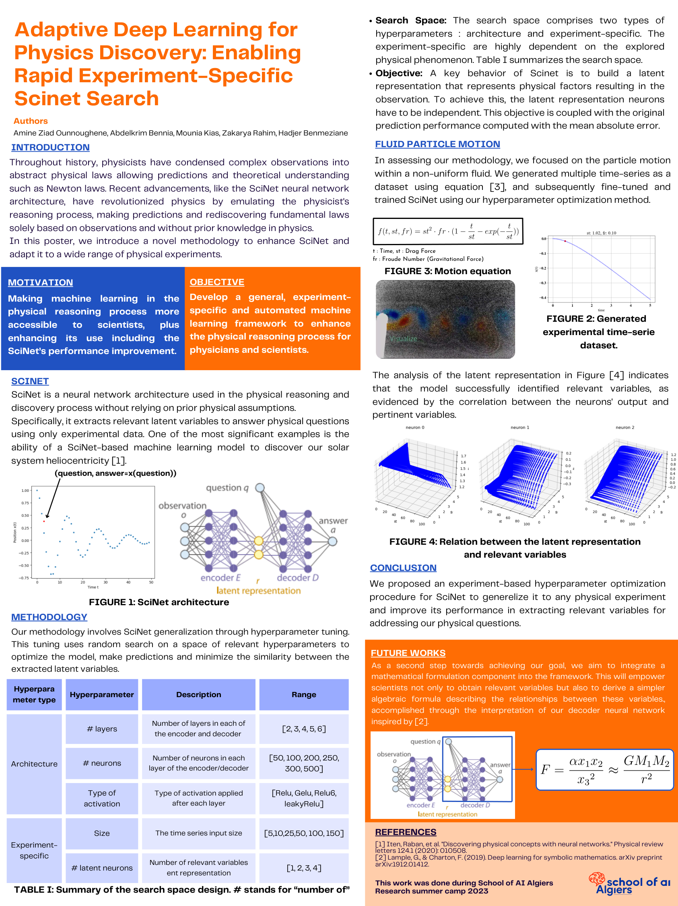

# AI for Physics Discovery

### Adaptive deep learning for experiment-specific SciNet models

**Scientific machine learning · Interpretable representations · PyTorch · Symbolic discovery**

Exploring how neural networks can compress physical observations into meaningful latent representations and use those representations to answer questions about a physical system.

**[View the research poster](assets/RSC_physics_discovery.pdf)** ·

## Project overview

Physical observations often contain more information than is needed to describe a system. This research explores whether a compact neural representation can capture the underlying factors that govern its behavior.

Our work builds on **SciNet**, an encoder–decoder architecture that learns from observations and predicts answers to physical questions. The research poster proposes adapting SciNet to individual experiments through hyperparameter search, with a case study involving simulated particle motion in a non-uniform fluid.

Developed during the **School of AI Algiers Research Camp 2023**, this collaborative project connects representation learning, physical prediction, and exploratory mathematical formula discovery.

## Research questions

- Can a compact latent representation capture relevant factors in a simulated physical system?
- How do model architecture and observation length affect the learned representation?
- How can predictive performance be balanced with a less redundant latent representation?
- Can learned representations support the search for interpretable mathematical expressions?

## Findings and interpretation

The poster presents qualitative relationships between learned latent neuron outputs and the simulation parameters. These observations suggest that the representation captures information relevant to the modeled physical system.

The project does not establish universal generalization to arbitrary physical experiments. Correlation with simulation parameters alone does not establish a unique or fully disentangled physical interpretation. Mathematical-expression extraction remains an exploratory research direction.

## Authors and project provenance

**Amine Ziad Ounnoughene, Abdelkrim Bennia, Mounia Kias, Zakarya Rahim, and Hadjer Benmeziane.**

This repository presents our collaborative research project and its poster. The original project code is hosted in [Amine Ziad Ounnoughene's physics_discovery repository](https://github.com/amine-ziad-ounnoughene/physics_discovery). This GitHub copy retains the original project attribution and adds presentation materials and documentation.

**Research setting:** School of AI Algiers Research Summer Camp 2023.

## References

1. Iten, R., et al. *Discovering Physical Concepts with Neural Networks*. Physical Review Letters 124, 010508 (2020). Referenced in the research poster.
2. Lample, G., and Charton, F. *Deep Learning for Symbolic Mathematics*. arXiv:1912.01412 (2019). Referenced in the research poster.
3. [SRSD Feynman Easy dataset](https://huggingface.co/datasets/yoshitomo-matsubara/srsd-feynman_easy), referenced by the formula-discovery notebook.

## Future directions

- Implement and document a reproducible experiment-specific hyperparameter search.
- Evaluate prediction accuracy and latent-variable relationships on held-out simulations.
- Compare configurations across multiple physical systems and random seeds.
- Investigate symbolic expressions derived from learned representations.
- Consolidate dependencies, experiment settings, and results into a reproducible workflow.
